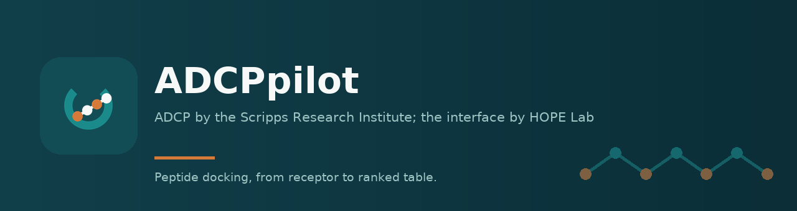

<p align="center">
  
</p>

GUI to ADCP Docking provides a browser interface and command-line workflow for peptide docking with [AutoDock CrankPep (ADCP)](https://ccsb.scripps.edu/adcp/). It connects receptor preparation, grid generation, docking, optional MM-GBSA rescoring, and reporting. Calculations can run on a Slurm cluster, a local computer, or Google Colab.

Provide a receptor structure and peptide sequences to generate predicted poses and a ranked results table. ADCP performs the docking calculations. This package manages the surrounding workflow.

Developed by Aadhil Haq, HOPE Lab, under the supervision of Dr. Sandun Fernando. This project is independent of the Scripps Research Institute, which developed ADCP and ADFRsuite.

## Workflow

```text
Receptor structure and peptide sequences
    → Receptor preparation
    → Receptor conversion and grid generation
    → ADCP docking for each peptide
    → Optional MM-GBSA rescoring
    → Structures, ranked results, and citation files
```

On Slurm, a preparation job is followed by an array with one task per peptide. Each task includes optional rescoring. The reporting job runs after the array terminates, so it can collect partial results when a task fails.

## Getting started

Choose where the calculations will run. [INSTALL.md](INSTALL.md) provides the full setup instructions, dependency requirements, and troubleshooting steps.

| Environment | Setup |
|---|---|
| Slurm cluster | Install the package and scientific tools on the cluster. Connect through SSH or the desktop launcher. |
| Local computer | Use Linux, macOS, or Windows through WSL, with the required scientific tools. |
| Google Colab | Open the [notebook](https://colab.research.google.com/github/aadhilhaq/ADCP_docking/blob/main/notebooks/ADCP_docking_colab.ipynb). Nothing is installed on your computer. |

### Slurm cluster

After setting up the environment described in [INSTALL.md](INSTALL.md#1-on-a-slurm-cluster):

```bash
git clone https://github.com/aadhilhaq/ADCP_docking.git
cd ADCP_docking
pip install -e ".[local]"
python -m adcp_dock.adfr --dest ~/tools/ADFRsuite
export ADFRSUITE_HOME=~/tools/ADFRsuite
adcp-dock check
adcp-dock serve --port 0
```

The server prints a local address and access token. Use SSH port forwarding to open that address from your computer, or use the optional [desktop launcher](https://github.com/aadhilhaq/ADCP_docking/releases). See [connection instructions](INSTALL.md#15-start-the-page).

Computational stages run as batch jobs. Follow your cluster's policy for hosting the interface server; an interactive-job option is described in the installation guide.

### Local computer

```bash
python3 -m venv ~/.adcp-dock/venv
~/.adcp-dock/venv/bin/pip install "adcp-dock[local] @ git+https://github.com/aadhilhaq/ADCP_docking"
~/.adcp-dock/venv/bin/adcp-dock local
```

The first launch installs ADFRsuite if needed. MM-GBSA requires a separate AmberTools installation. Platform requirements are listed in [INSTALL.md](INSTALL.md#2-on-your-own-computer).

### Google Colab

[](https://colab.research.google.com/github/aadhilhaq/ADCP_docking/blob/main/notebooks/ADCP_docking_colab.ipynb)

The notebook runs the same interface on a Colab machine. Step 1 installs the package and downloads ADFRsuite, which takes about five minutes; with **add_MM_GBSA** ticked it also installs AmberTools for MM-GBSA rescoring, which takes a few minutes more. Step 2 opens the interface inside the notebook, or in a separate browser tab. The list of runs includes a finished example, MDM2 with three peptides, to open before docking anything. The calculations run on the Colab machine, so the available cores, memory, and session length depend on your Colab plan, and MM-GBSA on two cores is slow. Colab deletes the session's files when it ends; download finished runs from the interface, or with step 3. See [INSTALL.md](INSTALL.md#3-in-google-colab).

Local and Colab runs are useful for learning the workflow and checking inputs. Reduced search settings do not establish sampling convergence. Choose production settings for the target, peptide, and available resources.

### Command line

Example commands, after configuring the required tools:

```bash
adcp-dock new runs/trial -r 1YCR --chain A \
    -s A:54,A:62,A:67,A:96,A:99 -p "p53: ETFSDLWKLLP" --poses 10 --mmgbsa
adcp-dock run runs/trial
adcp-dock status runs/trial
adcp-dock report runs/trial
```

`-r` accepts a structure path or PDB ID. `-s` specifies residues used to define the docking box. Use `-p` for individual peptides or `-f` for a peptide file. Remove `--mmgbsa` if rescoring is not required. Review the search and resource settings before submitting a run.

Running `adcp-dock run` again submits peptides without completed results.

ADCP 1.1 is supported alongside ADCP 1.0, with non-standard and D amino acids (`N<BHD>PIS&DVD`), OpenMM minimization of the top poses, and runs that start from a target file made in AGFRGUI. Install it with `adcp-dock install-adcp11`; see [INSTALL.md](INSTALL.md#3a-adcp-11-optional).

`adcp-dock example` copies a finished example run into the runs folder: MDM2 with three peptides, docked and rescored with MM-GBSA. Open it in the interface to see what a finished run contains.

## Requirements

Python 3.9 or newer, NumPy, and RDKit are required.

| Tool | Source | Purpose |
|---|---|---|
| `adcp`, `agfr`, `prepare_receptor` | ADFRsuite | Docking, grid generation, and receptor conversion |
| `pdb2pqr` | PDB2PQR | Protonation at the selected pH |
| `tleap`, `sander`, `MMPBSA.py` | AmberTools | Optional MM-GBSA rescoring |
| `sbatch` | Slurm | Cluster execution |

PDBFixer, OpenMM, and Biopython support structural repair, restrained minimization, and mmCIF input. The preparation log reports unavailable steps.

Run `adcp-dock check` to inspect the installation. The ADFRsuite installer checks the downloaded archive against a pinned checksum. Fetching a receptor by PDB ID requires internet access; downloaded entries are cached.

## Peptide input

Use one-letter amino acid codes for sequences of 5 to 30 residues. The parser rejects B, J, O, U, X, and Z.

Supported formats are a sequence, a named sequence, or FASTA:

```text
ETFSDLWKLLP
```

```text
p53: ETFSDLWKLLP
```

```fasta
>p53
ETFSDLWKLLP
```

Lines beginning with `#` are comments. Use a colon to separate a name from its sequence. Spaces within sequence lines are removed.

## Results and interpretation

The report writes `results.tsv`, `results.json`, and `results.txt`. The default ranking uses the mean of up to five top poses. If MM-GBSA summaries are available, the report uses that ranking criterion; otherwise it uses ADCP scores. Peptides without a value for the selected criterion remain in the report without a rank.

The report also includes individual score summaries, pose counts, and available measures of score variation. Variation across poses does not establish statistical significance, uncertainty in binding affinity, or convergence of the search. Inspect the structures and sampling settings alongside the scores.

Use MM-GBSA as an approximate ranking aid within a consistently prepared run. These values are not experimentally measured binding free energies or dissociation constants.

Each run in the interface's list can be opened, reused as the starting point for a new run, downloaded, reported as an issue, shown on disk, or deleted. **folder** opens the run in your file manager when the interface runs on your own computer; on a cluster or in Colab it shows the run's path and how to reach it. **delete** asks first, removes the run's folder permanently, and is refused while any of the run's jobs is queued or running.

## Workflow checks

The workflow checks grid-target contents before docking, identifies receptor and peptide selections by chain for rescoring, and checks bonded-energy cancellation in single-trajectory MM-GBSA calculations. Poses that fail the rescoring consistency check are excluded from those results.

Preparation decisions and incomplete steps are recorded in the logs, and the results page reports when the receptor preparation was incomplete. Review these records before interpreting a ranking. Passing workflow checks does not validate the predicted binding pose or affinity.

## Tests and contributions

Run the test suite on an allocated compute node:

```bash
srun --pty -c 8 -t 30 bash tests/run_all.sh
```

Add the account and partition required by your cluster. Test scripts report pass, skip, or failure; skipped checks have not been verified. See [CONTRIBUTING.md](CONTRIBUTING.md) for individual tests, contribution guidance, and the shared engine modules.

Report problems through [GitHub Issues](https://github.com/aadhilhaq/ADCP_docking/issues) or **Send feedback** in the interface. Include the software revision, settings, relevant log output, and steps to reproduce the problem.

## Citation

This interface drives other programs, and each has its own paper. Cite the ones your run used; `adcp-dock cite <run>` and the `HOW_TO_CITE.txt`, `CITATION.bib` and `CITATION.ris` files written into every run list exactly those. ADCP and ADFRsuite are products of the Scripps Research Institute. The Amber developers ask for the AmberTools paper and the force field paper ([ambermd.org/CiteAmber.php](https://ambermd.org/CiteAmber.php)).

| Tool | Cite for | Reference | DOI |
|---|---|---|---|
| ADCP | every run | Zhang Y, Sanner MF. AutoDock CrankPep: combining folding and docking to predict protein-peptide complexes. Bioinformatics 35(24):5121-5127, 2019. | [10.1093/bioinformatics/btz459](https://doi.org/10.1093/bioinformatics/btz459) |
| ADFRsuite (agfr, prepare_receptor) | every run | Ravindranath PA, Forli S, Goodsell DS, Olson AJ, Sanner MF. AutoDockFR: advances in protein-ligand docking with explicitly specified binding site flexibility. PLoS Comput Biol 11(12):e1004586, 2015. | [10.1371/journal.pcbi.1004586](https://doi.org/10.1371/journal.pcbi.1004586) |
| AutoGrid4 | every run | Morris GM, Huey R, Lindstrom W, Sanner MF, Belew RK, Goodsell DS, Olson AJ. AutoDock4 and AutoDockTools4: automated docking with selective receptor flexibility. J Comput Chem 30(16):2785-2791, 2009. | [10.1002/jcc.21256](https://doi.org/10.1002/jcc.21256) |
| AutoSite | every run | Ravindranath PA, Sanner MF. AutoSite: an automated approach for pseudo-ligands prediction—from ligand-binding sites identification to predicting key ligand atoms. Bioinformatics 32(20):3142-3149, 2016. | [10.1093/bioinformatics/btw367](https://doi.org/10.1093/bioinformatics/btw367) |
| PDB2PQR | every run | Jurrus E, Engel D, Star K, et al. Improvements to the APBS biomolecular solvation software suite. Protein Sci 27(1):112-128, 2018. | [10.1002/pro.3280](https://doi.org/10.1002/pro.3280) |
| PROPKA | every run | Olsson MHM, Sondergaard CR, Rostkowski M, Jensen JH. PROPKA3: consistent treatment of internal and surface residues in empirical pKa predictions. J Chem Theory Comput 7(2):525-537, 2011. | [10.1021/ct100578z](https://doi.org/10.1021/ct100578z) |
| PDBFixer | receptor preparation (default) | Eastman P, et al. OpenMM 7: rapid development of high performance algorithms for molecular dynamics. PLoS Comput Biol 13(7):e1005659, 2017.  (PDBFixer is distributed with OpenMM.) | [10.1371/journal.pcbi.1005659](https://doi.org/10.1371/journal.pcbi.1005659) |
| OpenMM | receptor minimization (default) | Eastman P, et al. OpenMM 7: rapid development of high performance algorithms for molecular dynamics. PLoS Comput Biol 13(7):e1005659, 2017. | [10.1371/journal.pcbi.1005659](https://doi.org/10.1371/journal.pcbi.1005659) |
| AmberTools (tleap, sander) | runs with MM-GBSA | Case DA, et al. AmberTools. J Chem Inf Model 63(20):6183-6191, 2023. | [10.1021/acs.jcim.3c01153](https://doi.org/10.1021/acs.jcim.3c01153) |
| ff14SB force field | runs with MM-GBSA | Maier JA, Martinez C, Kasavajhala K, Wickstrom L, Hauser KE, Simmerling C. ff14SB: improving the accuracy of protein side chain and backbone parameters from ff99SB. J Chem Theory Comput 11(8):3696-3713, 2015. | [10.1021/acs.jctc.5b00255](https://doi.org/10.1021/acs.jctc.5b00255) |
| MMPBSA.py | runs with MM-GBSA | Miller BR III, McGee TD Jr, Swails JM, Homeyer N, Gohlke H, Roitberg AE. MMPBSA.py: an efficient program for end-state free energy calculations. J Chem Theory Comput 8(9):3314-3321, 2012. | [10.1021/ct300418h](https://doi.org/10.1021/ct300418h) |
| GB-OBC(II) solvation model | runs with MM-GBSA | Onufriev A, Bashford D, Case DA. Exploring protein native states and large-scale conformational changes with a modified generalized born model. Proteins 55(2):383-394, 2004. | [10.1002/prot.20033](https://doi.org/10.1002/prot.20033) |
| 3Dmol.js | figures made in the 3Dmol.js viewer | Rego N, Koes D. 3Dmol.js: molecular visualization with WebGL. Bioinformatics 31(8):1322-1324, 2015. | [10.1093/bioinformatics/btu829](https://doi.org/10.1093/bioinformatics/btu829) |
| Mol* | figures made in the Mol* viewer | Sehnal D, Bittrich S, Deshpande M, et al. Mol* Viewer: modern web app for 3D visualization and analysis of large biomolecular structures. Nucleic Acids Res 49(W1):W431-W437, 2021. | [10.1093/nar/gkab314](https://doi.org/10.1093/nar/gkab314) |
| NumPy | every run | Harris CR, Millman KJ, van der Walt SJ, et al. Array programming with NumPy. Nature 585(7825):357-362, 2020. | [10.1038/s41586-020-2649-2](https://doi.org/10.1038/s41586-020-2649-2) |
| RDKit | every run | RDKit: Open-source cheminformatics. https://www.rdkit.org | [10.5281/zenodo.591637](https://doi.org/10.5281/zenodo.591637) |

```bash
adcp-dock cite                 # all supported tools
adcp-dock cite <run>           # tools recorded for one run
adcp-dock cite --bibtex        # use --ris for EndNote or Zotero
```

For this interface, use GitHub's **Cite this repository** button or [CITATION.cff](CITATION.cff), and record the software version used.

## License

This package is distributed under the [MIT license](LICENSE), which covers only the code written for it. ADCP, ADFRsuite, AmberTools, PDB2PQR and the other programs and libraries it uses keep their own licences; [THIRD_PARTY_NOTICES.md](THIRD_PARTY_NOTICES.md) lists each one, how it is used and how it is obtained. No Scripps code is included in this repository.
